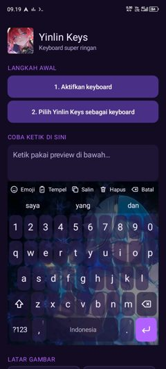
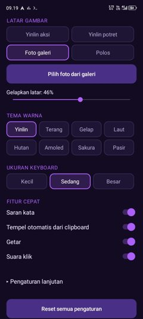

# Yinlin Keys

Super light keyboard for Android. Pure Java, no libraries.

**[Download APK](../../releases/latest)**

Android 5+ · 161 KB · no ads · no internet

## Features

| | |
|---|---|
| **Suggest** | Word suggestions from a built-in dictionary, works offline. |
| **Undo** | The Batal button deletes the last word, press again for the one before. |
| **Clipboard** | Copied text shows up in the suggestion bar, tap to paste. |
| **Themes** | 8 color themes, custom background photo, vibration and click sound. |

## Install

1. Download the latest APK on the [Releases](../../releases) page.
2. Open the APK file and allow installation from this source.
3. Open Yinlin Keys, follow step 1 and 2 on the screen.
